# IPTVnator for Android

One APK for **Android TV, phones, foldables and tablets**. It packages the
[IPTVnator](https://github.com/4gray/iptvnator) TV client (`apps/tv`) in a
Capacitor shell and adds:

- a native Android experience for each screen size;
- one navigation model, the same on remote and touch;
- an on-device backend, so **no server is needed**.

Add your Xtream, Stalker or M3U source and watch.

<p>
  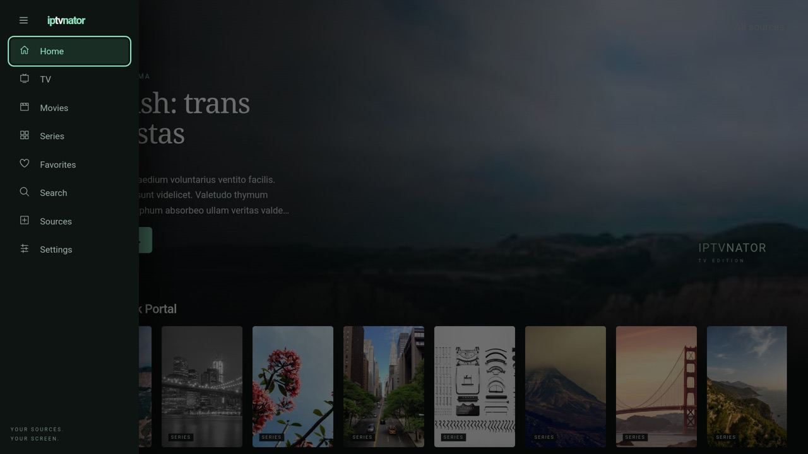
  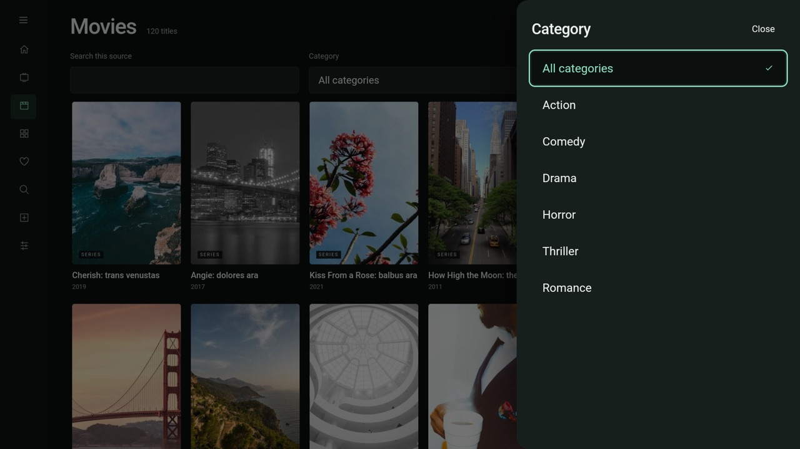
</p>
<p>
  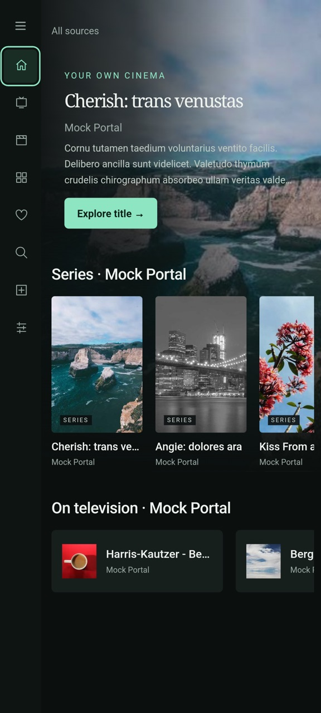
  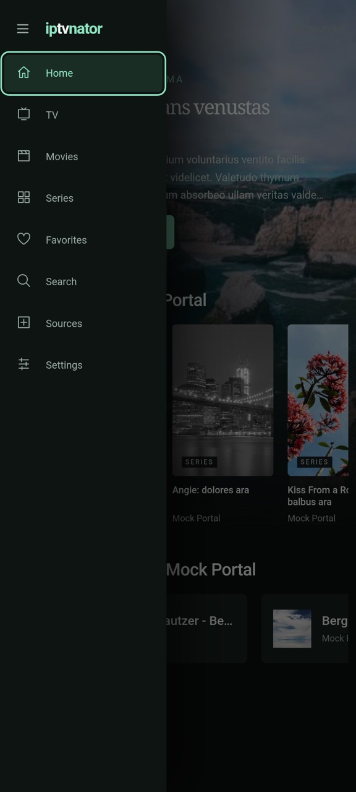
  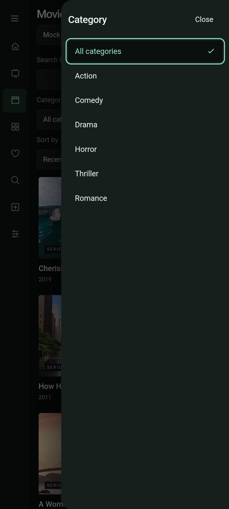
  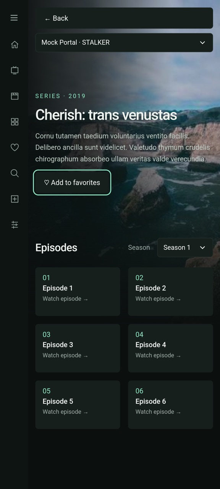
  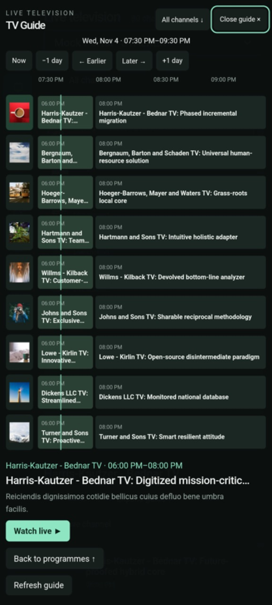
</p>

> Not affiliated with the IPTVnator maintainers. IPTVnator does not provide any
> content; bring your own subscription.

## Contents

- [The experience](#the-experience)
- [Controls](#controls)
- [Every screen size](#every-screen-size)
- [Install](#install)
- [Build](#build)
- [Testing](#testing)
- [How it works](#how-it-works)
- [Releasing](#releasing)

## The experience

The app follows a few rules so that browsing feels the same everywhere and never
fights the user:

| Principle | What it means in the app |
| --- | --- |
| **One mental model** | The same rail, side panels, quick menu and OSD on TV, phone, foldable and tablet. Only sizes change. |
| **Content first** | The rail is a slim icon strip while you browse. It slides open with labels only when you reach for it, and slides shut as soon as you choose. |
| **Choices slide in, never jump** | Category, season, sort and source pickers are side panels that slide in from the right and back out. |
| **Never lose your place** | Pickers, the quick menu and channel zapping all work on top of what you were doing. Back always closes the top layer first. |
| **Feedback for every press** | Seeking, scanning, speed changes and channel switches show a short on-screen display with where you are. |
| **The device does the obvious thing** | Phones turn to landscape for fullscreen video. A half-folded foldable becomes a tabletop player. The TV keeps the screen awake only while video plays. |

### Navigation rail

| TV | Phone |
| --- | --- |
|  |  |

- **TV:** press ← from the content to slide the rail open, choose with OK. It slides shut and
  focus moves into the page.
- **Touch:** tap ☰. Tap a destination, tap outside, swipe left or press Back to close.
  There is deliberately no edge swipe, because on Android the left edge is the system Back gesture.

### Side panels for categories, seasons and sorting

| Movie categories (TV) | Seasons (TV) |
| --- | --- |
|  | 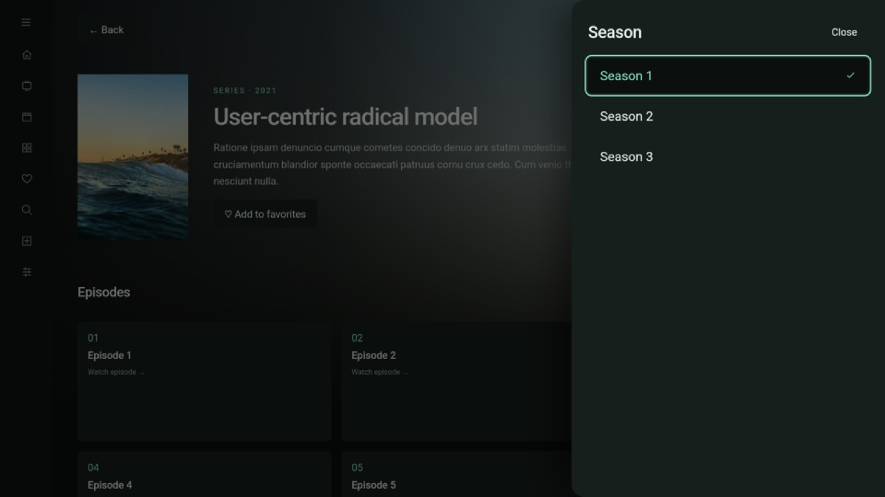 |

### Player and quick menu

| Quick menu (TV) | Quick menu (phone, auto-landscape) |
| --- | --- |
| 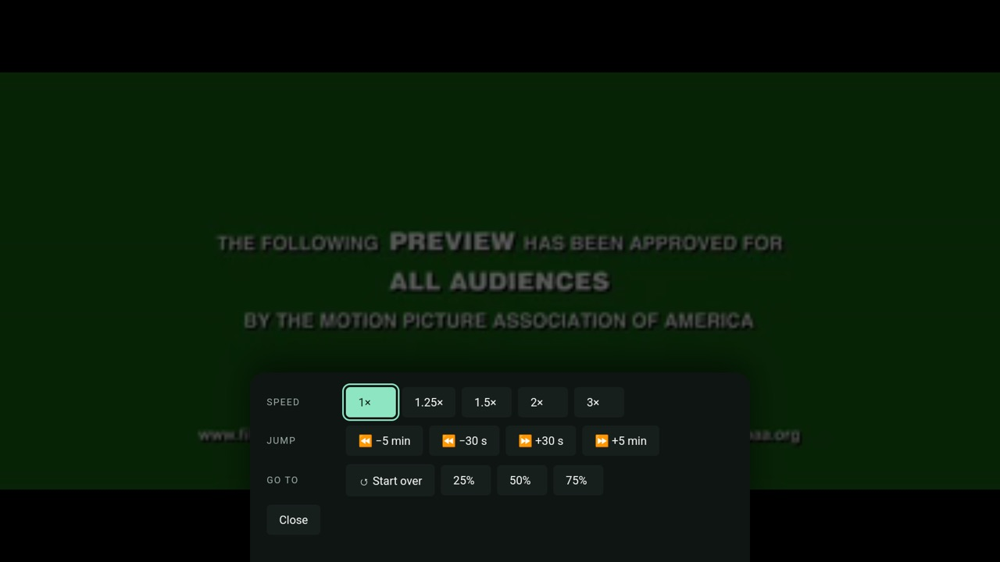 | 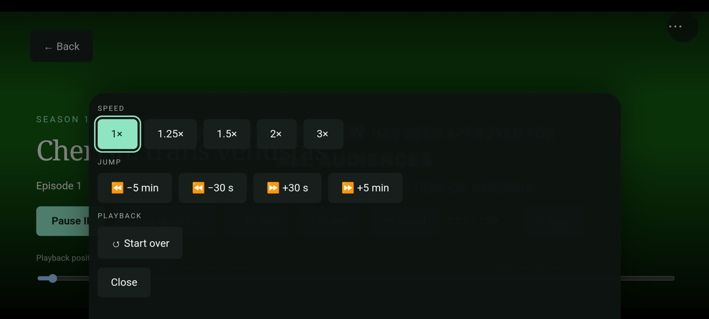 |

For movies and episodes the quick menu offers speed (1×, 1.25×, 1.5×, 2×, 3×), jumps of
±30 s and ±5 min, and **Go to** Start over / 25% / 50% / 75%. The menu stays open after a
jump, so +5 min can be pressed again and again. For live TV it offers Channels, TV Guide
and Programme.

| Speed button in the controls (TV) | Same on phone |
| --- | --- |
| 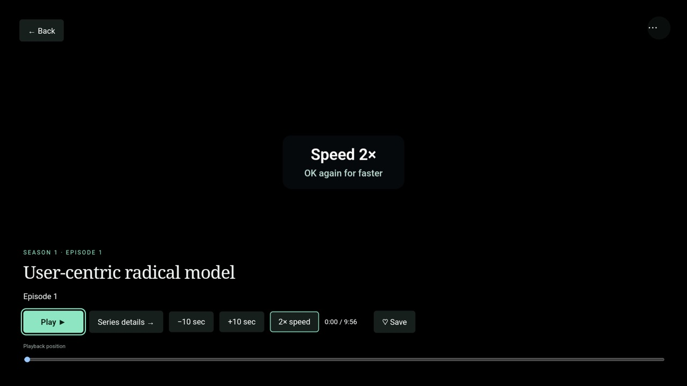 | 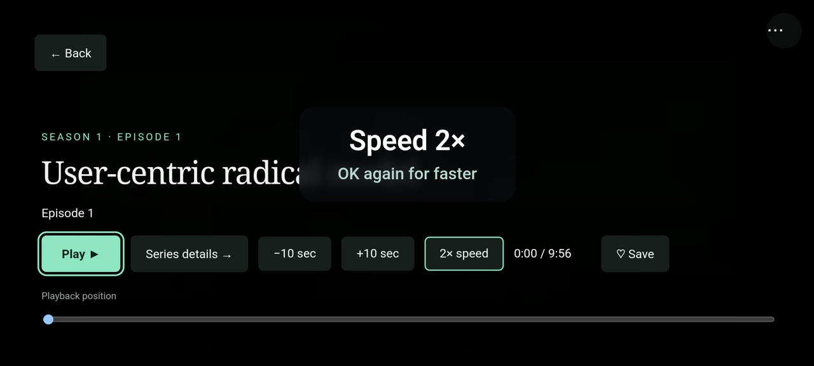 |

The control row also has a **Speed** button next to −10 / +10 sec. Each press of OK (or a
tap) steps through 1× → 1.25× → 1.5× → 2× → 3× → 1×, so speed is always one visible press
away, even with the controls on screen. The play/pause button and the time readout keep a
fixed width, so the row never shifts while you seek.

### Live TV

| Live (TV) | Zapping with ↓ / CH± (TV) | TV guide (TV) |
| --- | --- | --- |
| 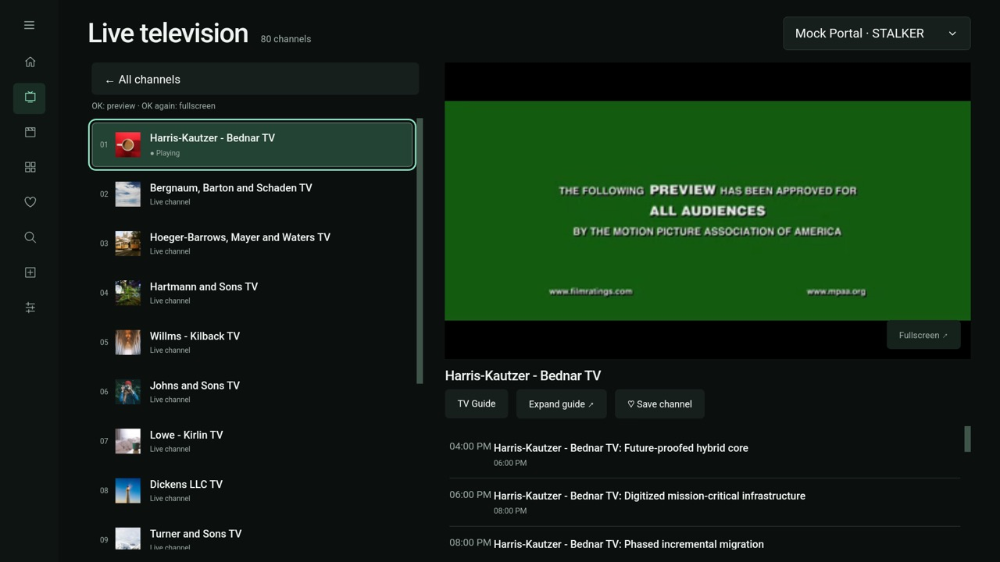 | 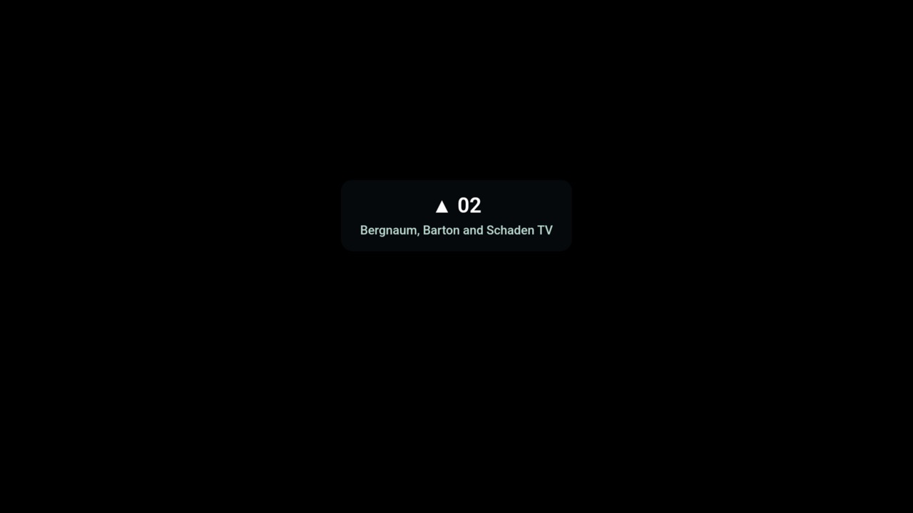 | 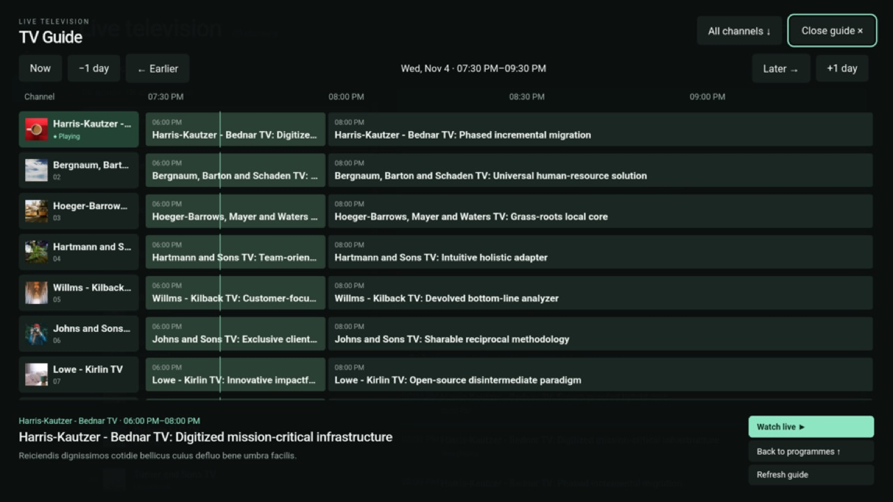 |

## Controls

| Action | Remote (TV) | Touch (phone, foldable, tablet) |
| --- | --- | --- |
| Open the menu | ← from the content | ☰ |
| Play / pause | OK | Pause button |
| Skip ±10 s | tap ← / → | double-tap left / right third |
| Scan | hold ← / → (20 → 60 → 180 s per second, seeks on release) | drag the seek bar |
| Scan with the controls showing | hold ← / → (a single press still moves focus) | n/a |
| Jump to a point | **0–9**: start, 10% … 90% (5 is the middle); quick menu **Go to** 25 / 50 / 75%; on the progress bar each ← / → moves 2% of the title | drag the seek bar |
| Speed | **Speed** button in the controls (1× → 1.25× → 1.5× → 2× → 3×) | **Speed** button, or press and hold: 2× while held |
| Show / hide the controls | ↑ or Info shows them; Back hides them at once | tap |
| Quick menu | ↓ (controls hidden), Menu, or hold OK | swipe up, or ⋯ |
| Next / previous channel (live) | ↓ / ↑ (also with the controls showing), CH+ / CH−, ⏭ / ⏮ | Channels in the quick menu |
| TV guide (live) | Guide key | TV Guide in the quick menu |
| Mute | Mute key toggles the player's sound when the remote sends it to apps; the TV's own mute and volume stay with Android | system volume |
| Subtitles / audio language | Captions and Audio keys switch tracks when the stream has them | n/a |
| Media keys | ⏯ ⏪ ⏩ ⏹ work everywhere | n/a |
| Back | hides the player controls, then closes the top layer: panel, menu, player, then screen; on Home it asks "Press Back again to exit" | system Back |

Apart from the held ← / → and ↑/↓ on live TV, remote gestures act only while the player
controls are hidden, so normal focus navigation is untouched whenever they are on screen.
Some TVs keep certain keys for themselves: on an NVIDIA SHIELD the system takes Menu and
Guide, so use ↓ or hold OK for the quick menu there.

## Every screen size

The TV client is designed in CSS pixels for a 1920×1080 TV and has breakpoints at
1400px and 900px. The shell chooses the layout width from the **Android window size
class** and keeps it up to date as the window rotates, folds, unfolds or resizes:

| Device | Window | Layout |
| --- | --- | --- |
| Android TV / Google TV | any | 1920, the 10-foot design |
| Phone portrait, fold cover screen | width < 600 dp | 600: icon rail, 3-column posters, single-column screens |
| Phone landscape | height < 480 dp | 1280: dense two-column layout |
| Unfolded foldable, tablet | everything else | the window's own width (min 840, max 1920) at native scale |

| Foldable unfolded | Foldable folded (cover) | Tabletop posture |
| --- | --- | --- |
| 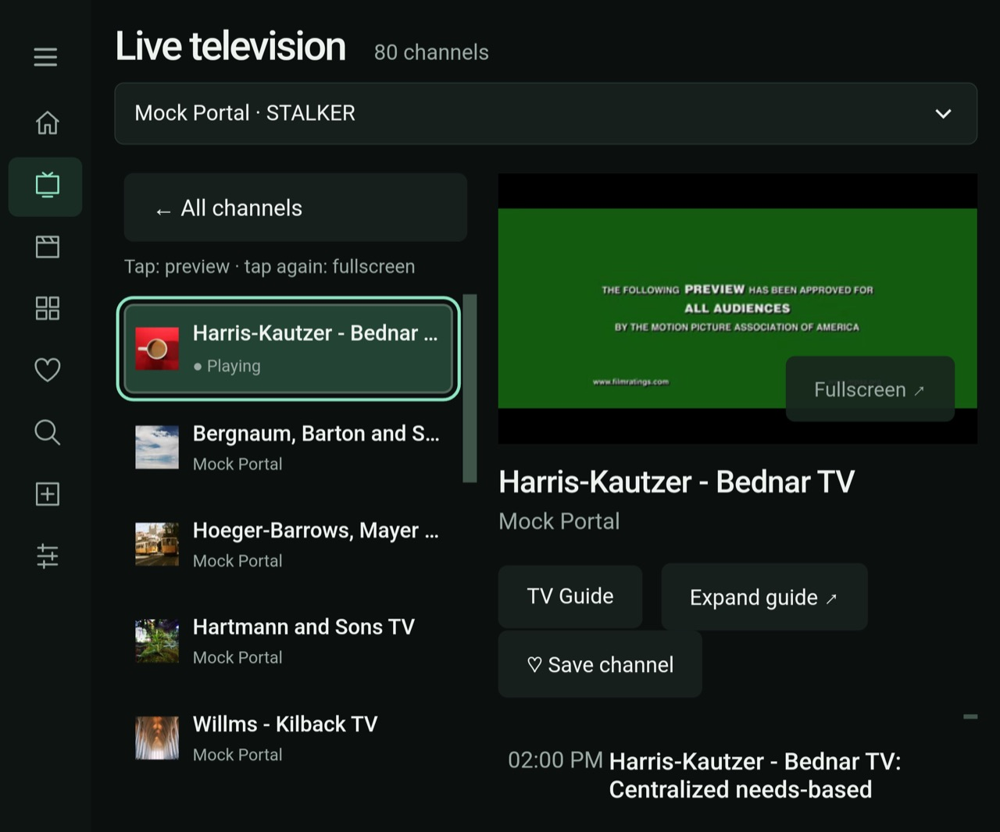 | 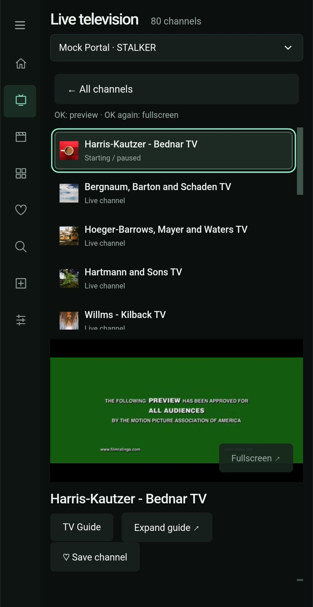 | 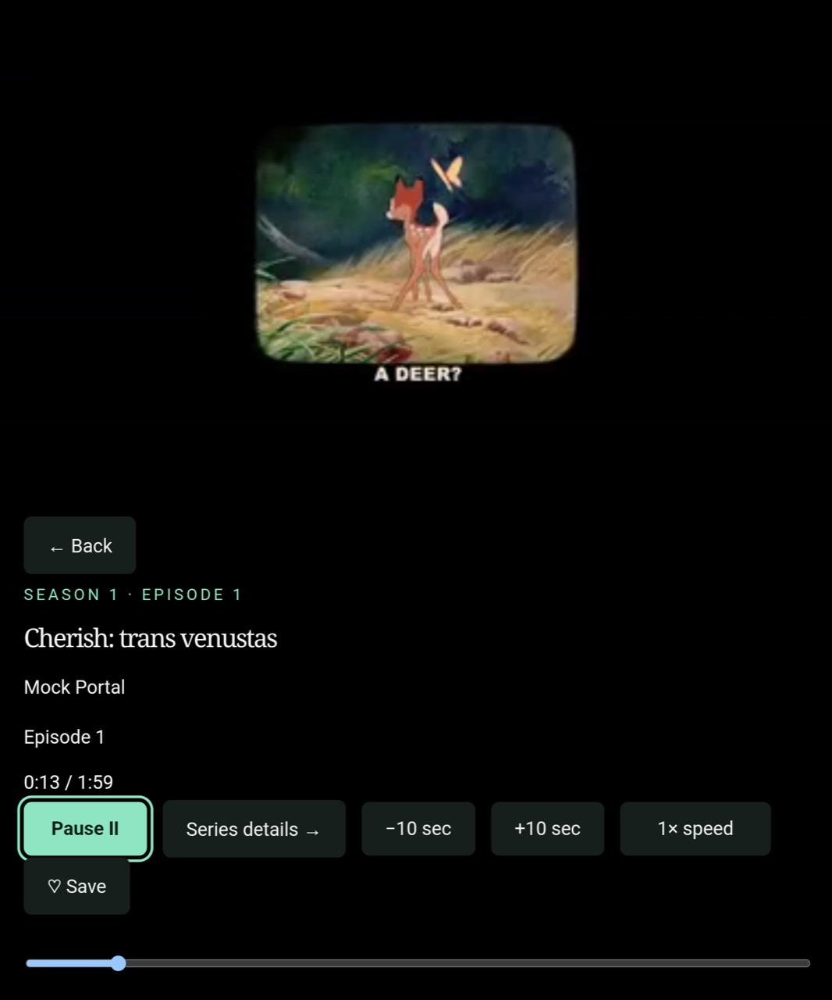 |

| Tablet portrait | Tablet landscape | Phone landscape |
| --- | --- | --- |
| 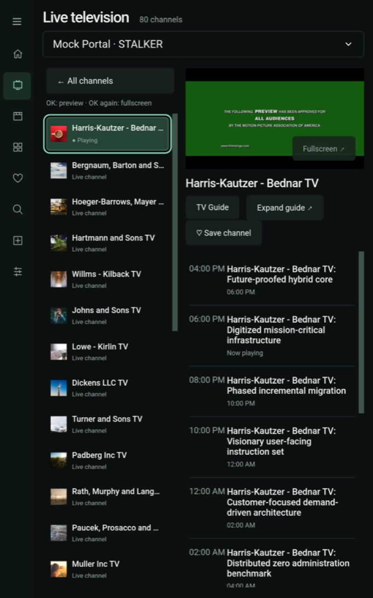 | 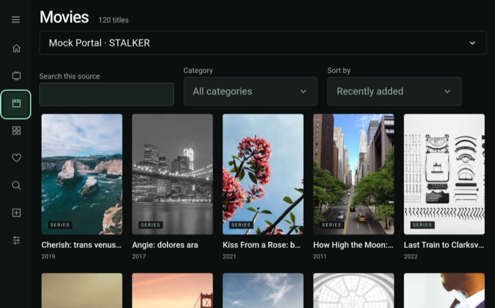 | 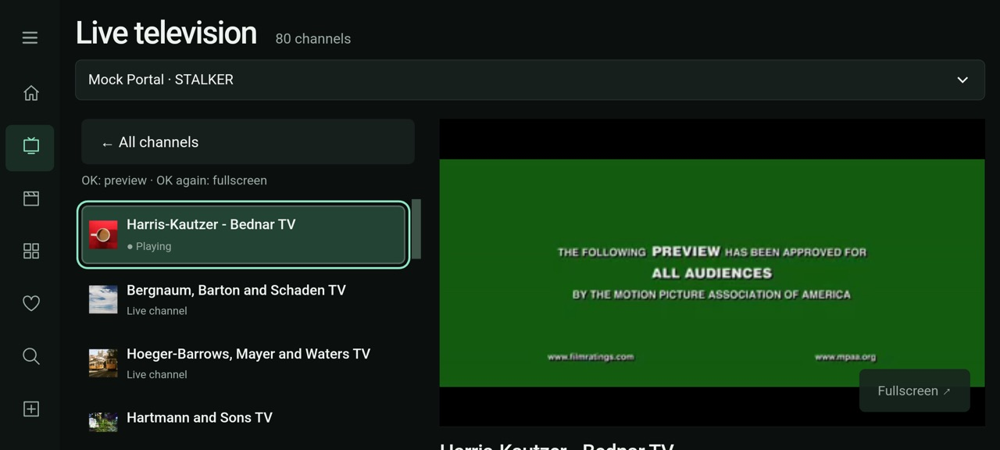 |

- **Tabletop:** half-fold a foldable with the hinge horizontal during playback. The
  picture moves above the hinge and the controls stay visible on the flat half.
- **Orientation:** compact phones rotate to landscape for fullscreen video and return
  afterwards. Tablets and unfolded foldables are never forced.

## Install

Download `IPTVnator-Android-x.y.z.apk` from
[Releases](../../releases) and check it against `SHA256SUMS`.

- **Android TV / Google TV:** sideload with a USB stick and a file manager, or run
  `adb install IPTVnator-Android-x.y.z.apk`. The app appears in the TV launcher (Leanback).
- **Phone / tablet:** open the APK and allow installing from your browser or file manager.

Then open **Sources** and add an Xtream, Stalker (portal URL plus MAC) or M3U source.

## Build

Requirements: Node 24, pnpm 10, JDK 21 (Android Studio's JBR works) and Android SDK 35.

```sh
pnpm install
pnpm run build:client          # builds ../iptvnator (or $IPTVNATOR_DIR) at the pinned commit
pnpm run build:apk             # -> android/app/build/outputs/apk/debug/app-debug.apk
```

`upstream.json` pins the IPTVnator commit. `node scripts/build-client.mjs --checkout`
clones or checks out exactly that commit, as CI does.

## Testing

```sh
pnpm test                      # typecheck + 33 unit tests
```

The **unit tests** (`tests/unit`) cover:

- the on-device backend routes against a mocked native HTTP layer: the Stalker MAC
  travels only as a cookie, provider errors return the same envelope as the real
  backend, Xtream and M3U parsing work;
- scan acceleration, double-tap sides and swipe detection;
- channel zapping;
- quick-menu spatial focus;
- form-factor selection for every device class;
- tabletop posture.

The **E2E suites** (`tests/e2e`) drive the real APK on emulators over the Chrome
DevTools Protocol, against IPTVnator's Stalker mock portal. They also write the
screenshots used in this README.

```sh
# in ../iptvnator: the Stalker mock portal on the host (emulators reach it at 10.0.2.2)
HOST=0.0.0.0 PORT=3210 NODE_ENV=development pnpm tsx --tsconfig tsconfig.base.json apps/stalker-mock-server/src/main.ts

pnpm run test:e2e:tv           # Android TV emulator (emulator-5556)
pnpm run test:e2e:phone        # phone emulator (emulator-5554)
FORM=fold node --test tests/e2e/app.e2e.mjs   # Pixel Fold emulator (emulator-5558)
./scripts/optimize-screenshots.sh             # refresh the README images
```

The suites cover:

| Area | TV | Phone | Fold |
| --- | :---: | :---: | :---: |
| Fresh install uses the on-device backend; layout and size class are correct with no horizontal overflow | ✔ | ✔ | ✔ |
| Add a Stalker portal through the form; home, movies and series load | ✔ | ✔ | ✔ |
| Rail slides open and shut | ✔ | ✔ | ✔ |
| Category panel slides in and fully out | ✔ | ✔ | ✔ |
| Episode plays (auto-landscape on phone) | ✔ | ✔ | ✔ |
| Quick menu sets speed, Back closes it | ✔ | ✔ | ✔ |
| Speed button appears in the control row by itself and cycles 1× … 3× → 1× | ✔ | ✔ | ✔ |
| ← / ↑ at the rail's edge keep focus in the open rail | ✔ | | |
| Remote tap/OK, ↑ shows and Back hides the controls, hold-to-scan (also with the controls up), Back leaves | ✔ | | |
| Progress bar by D-pad (2% per press); 5 jumps to the middle; quick-menu jumps repeat | ✔ | | |
| Control row does not move while speed, skips or pause change | ✔ | ✔ | ✔ |
| Live plays; ↓ and CH− zap stay in fullscreen, also with the controls showing | ✔ | ✔ (plays) | ✔ (plays) |
| Rotation (phone); fold → cover → unfold; tabletop | | ✔ | ✔ |

Last run: TV 20/20, fold 15/15, unit 52/52, sample portal 13/13, experience audit 81/81 on TV
and fold (phone 14/14 on an earlier build). The TV suite also passes on a
real NVIDIA SHIELD Android TV (Android 11, WebView 156) against the mock portal on the LAN:
`FORM=tv SERIAL=<ip>:5555 MOCK_PORTAL=http://<mac-ip>:3210/stalker_portal/server/load.php`.

**Sample portal.** `tests/sample-portal/server.mjs` is a local Stalker portal that behaves
like the real providers we test against, so most real-portal testing needs no provider at
all: 126 VOD categories of generated titles (films and lazy series mixed in the VOD
catalog, 14 per page), the category quirk some portals have (`category=<id>&genre=<id>`
answers an empty list, `genre=0` filters), a Series module that answers `js:false`, a
20-minute HLS movie with a frame counter for checking seeks, and live channels on a
rolling HLS window. It generates its video with ffmpeg on first start (into `build/`).

**Experience audit.** `tests/e2e/ux-audit.mjs` drives the app through every scenario
against the sample portal the way a viewer would (setup, browse and switch categories, play,
every remote key in the player, resume, series, live zapping and guide, search, Back) and
measures what a viewer feels: time to content and to picture, key response (and keys that do
nothing), layout shifts that were not caused by the viewer, focus lost on TV, and error banners
that should not be there. It writes `ux-audit.md` / `.json` with a score and budgets
(content ≤ 2.5 s, picture ≤ 4 s, key ≤ 150 ms, shift ≤ 0.05):

```sh
node tests/sample-portal/server.mjs &
OUT=build/ux SERIAL=emulator-5556 node tests/e2e/ux-audit.mjs                 # TV
OUT=build/ux-fold SERIAL=emulator-5558 CDP_PORT=9391 node tests/e2e/ux-audit.mjs
```

```sh
node tests/sample-portal/server.mjs   # http://0.0.0.0:3211/stalker_portal/server/load.php
SEARCH_TERM=sample PORTAL_URL=http://10.0.2.2:3211/stalker_portal/server/load.php \
  PORTAL_MAC=00:1A:79:12:34:56 SERIAL=emulator-5556 SHOTS=/tmp/sample node tests/e2e/portal-smoke.mjs
```

**Real portals.** `tests/e2e/portal-smoke.mjs` walks a real Stalker portal (add source,
home, live + zap, guide, movies, categories, playback, series, search) and prints a report.
It reads `PORTAL_URL` and `PORTAL_MAC` from the environment and never prints them; keep
`SHOTS` outside the repository, since the screenshots show provider content. Run it
sparingly and on one device at a time: Stalker portals allow one session per MAC and may
lock a MAC that handshakes too often.

## How it works

```
┌──────────────────────── Android WebView (Capacitor) ─────────────────────────┐
│  shell.js (this repo)                       IPTVnator TV client (upstream)     │
│  ├─ embedded-backend  fetch(iptvnator.device/*) ──► routes answered in-app    │
│  │                     (+ stalker-category: portal category/series quirks)    │
│  │                     └─► CapacitorHttp (native: Cookie/UA headers, no CORS)  │
│  ├─ form-factor       viewport + size-class from the native window size        │
│  ├─ nav-rail          slide-in rail (focus on TV, ☰ on touch)                   │
│  ├─ sheet-motion      slide-out for the client's pickers                       │
│  ├─ player-gestures   remote + touch gestures, OSD                             │
│  ├─ controls-visibility  ↑ shows, Back hides the player controls              │
│  ├─ remote-keys       0–9 jumps, mute, captions, audio track, info            │
│  ├─ seek-bar · speed-button  remote-friendly progress bar, Speed button       │
│  ├─ quick-menu        player bottom sheet                                       │
│  ├─ channel-zap       ↑/↓, CH± via the client's channel drawer                 │
│  ├─ posture           tabletop layout                                          │
│  └─ tv-platform       Back, media keys, keep-screen-on                         │
├───────────────────────────── MainActivity.java ──────────────────────────────┤
│  Back → BrowserBack · Menu/Guide forwarding · immersive · isTelevision ·        │
│  windowSizeDp · tabletop (Jetpack WindowManager) · playback orientation          │
└──────────────────────────────────────────────────────────────────────────────┘
```

- The shell never forks the client. It runs before the client, answers its backend
  calls, and layers navigation, gestures and styles on top. A pinned upstream
  commit plus the E2E suites keep that contract honest.
- **Standalone:** fresh installs use the on-device backend (`http://iptvnator.device`).
  Stalker identity headers and URLs come from IPTVnator's own shared builders, so
  portals see the same requests as from the desktop app. Entering a different
  backend URL in Settings switches to that server instead.
- **Privacy:** no analytics. App data is excluded from cloud backup and device transfer.

## Releasing

Versioning, signing, CI and tagged GitHub releases are described in
[docs/RELEASING.md](docs/RELEASING.md). Changes are listed in [CHANGELOG.md](CHANGELOG.md).

## License

MIT, same as IPTVnator.
